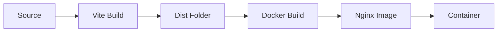

# System Architecture

## Overview

This portfolio is a **React + Vite** single-page application with Docker/Nginx deployment.

## Tech Stack

| Layer | Technology |
|-------|------------|
| Frontend | React 18, Vite |
| Styling | Custom CSS, CSS Variables |
| Build | Vite, esbuild |
| Deployment | Docker, Nginx |
| Container | Multi-stage build |

## Architecture Diagram

```
┌─────────────────┐
│   User Browser  │
└────────┬────────┘
         │ HTTPS
         ▼
┌─────────────────┐
│   Nginx (80)    │ ◄── Static files, SPA fallback
│   - Gzip        │
│   - Caching     │
└────────┬────────┘
         │
         ▼
┌─────────────────┐
│  React App      │
│  - SPA Router   │
│  - Components   │
│  - State Mgmt   │
└─────────────────┘
```

## Component Structure

```
App (ThemeProvider)
├── Navbar
├── Main
│   ├── Hero
│   ├── About
│   ├── Skills
│   ├── Services
│   ├── Projects
│   ├── Experience
│   ├── EducationWork
│   ├── Capabilities
│   │   ├── DevEnv
│   │   ├── Design
│   │   └── Documentation
│   ├── ToolsStrengths
│   │   ├── Tools
│   │   ├── StrengthsSection
│   │   ├── CertificatesSection
│   │   └── WhyHireMeSection
│   ├── Resume
│   └── Contact
└── Footer
```

## Data Flow

1. **Static Data**: `src/core/Profile.js` exports all portfolio data
2. **Components**: Import from `@core/Profile` and render
3. **Theme**: `ThemeContext` manages dark/light mode
4. **Animations**: `useScrollReveal` hook triggers reveal animations

## Build Process



## Related Pages

- [[getting-started]] - Setup instructions
- [[deployment]] - Production deployment
- [[api-reference]] - Component APIs